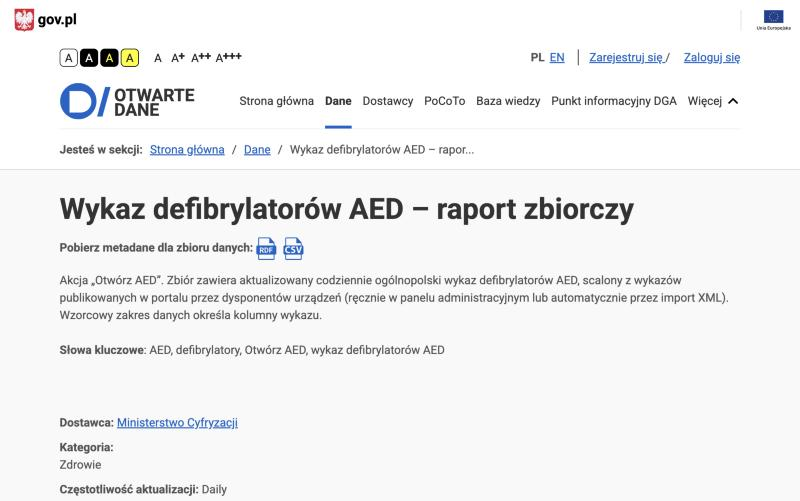
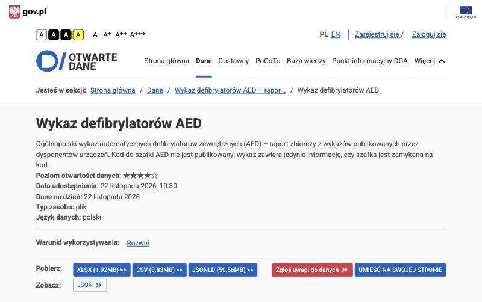
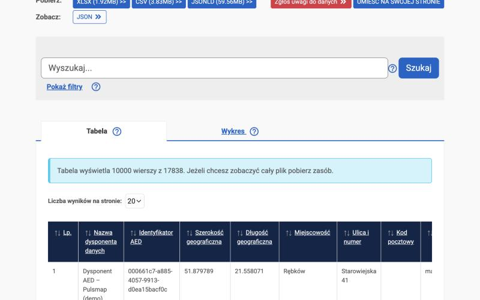

# Wykaz defibrylatorów AED w portalu dane.gov.pl

Integracja akcji „Otwórz AED” z **kodem źródłowym portalu dane.gov.pl**
(`backend_2.63.0`, [dane.gov.pl/source-code](https://dane.gov.pl/source-code/)).
Dane o AED nie są publikowane obok portalu, tylko **w portalu, jako zasoby**,
tym samym mechanizmem co istniejący *Wykaz zasobów chronionych danych (DGA)*.

## Jak to działa

| Element | DGA (istniejący w portalu) | AED (dodany przez nas) |
|---|---|---|
| Oznaczenie zasobu | `Resource.contains_protected_data` | `Resource.contains_aed_data` („Wykaz defibrylatorów AED”) |
| Zakres kolumn wykazu | `DGA_COLUMNS` | `AED_COLUMNS` (18 kolumn, `mcod/resources/aed_constants.py`) |
| Zasilanie ręczne | panel administracyjny – walidacja kolumn pliku | panel administracyjny – walidacja kolumn pliku xlsx/xls/csv |
| Zasilanie automatyczne | import XML, `containsProtectedData` | import XML (schemat 1.13), `containsAedData` |
| Wykaz zbiorczy | `create_main_dga_resource_task` (codziennie 3:30) | `create_main_aed_resource_task` (codziennie 3:45) → zbiór „Wykaz defibrylatorów AED – raport zbiorczy” |

Kolumny wykazu: Lp., Identyfikator AED, Szerokość geograficzna, Długość
geograficzna, Miejscowość, Ulica i numer, Kod pocztowy, Województwo, Opis
lokalizacji, Wewnątrz budynku, Dostępność, Szafka zamykana na kod, Godziny
dostępności, Status, Opiekun urządzenia, Telefon opiekuna, E-mail opiekuna,
Data aktualizacji danych. **Kod do szafki nie jest publikowany.**

**Pulsmap** pełni rolę narzędzia dysponenta: łączy dane z OSM i od dysponentów,
waliduje, deduplikuje i udostępnia:

- `GET /api/v1/export/wykaz-aed.csv` – wykaz AED w zakresie kolumn portalu (plik do zasilenia ręcznego i źródło zasobu przy imporcie),
- `GET /api/v1/export/dane-gov-pl.xml` + `dane-gov-pl.md5` – plik XML (schemat `xml_import_otwarte_dane_1_13.xsd` z `containsAedData`) dla źródła danych portalu.

## Pliki

- `wykaz-aed-backend-2.63.0.patch` – zmiany w backendzie portalu (16 plików: model + migracja `0076_aed_wykaz`, formularz i panel, harvester + XSD, zadanie Celery i harmonogram, polecenie `aed_demo_setup`, ścieżka `/pulsmap/` w nginx, poprawka budowania obrazu – gotowa paczka `gevent`).
- `srodowisko-lokalne-macos.patch` – ustawienia środowiska lokalnego (podsieć Dockera `172.28.18.0/24`, `host.docker.internal:host-gateway`, usunięty `timeout` z ustawień indeksów Elasticsearch w `local.py.sample`).

## Uruchomienie (sprawdzone na macOS, Docker Desktop 8 GB RAM)

```bash
# 1. Kod portalu
mkdir dane-gov-pl && cd dane-gov-pl
curl -LO https://dane.gov.pl/source-code/backend_latest.zip
curl -LO https://dane.gov.pl/source-code/frontend_latest.zip
unzip -q backend_latest.zip -d backend && unzip -q frontend_latest.zip -d frontend

# 2. Nasze zmiany
cd backend
git apply ../../pulsemap/integracja-dane-gov-pl/wykaz-aed-backend-2.63.0.patch
git apply ../../pulsemap/integracja-dane-gov-pl/srodowisko-lokalne-macos.patch
cp env.sample .env && sed -i '' 's/^DISCOURSE_FORUM_ENABLED=true/DISCOURSE_FORUM_ENABLED=false/' .env
cp mcod/settings/local.py.sample mcod/settings/local.py
```

```bash
# 3. Nazwy portalu (raz, wymaga hasła administratora)
sudo sh -c 'echo "127.0.0.1 mcod.local api.mcod.local admin.mcod.local cms.mcod.local" >> /etc/hosts'
```

```bash
# 4. Backend portalu (budowa obrazu ok. 5–15 min)
docker compose -f docker-compose.local.yml build mcod-db mcod-rabbitmq mcod-redis mcod-elasticsearch mcod-rdfdb mcod-nginx mcod-local-admin
docker compose -f docker-compose.local.yml up -d mcod-db mcod-rabbitmq mcod-redis mcod-elasticsearch mcod-rdfdb mcod-smtp
docker compose -f docker-compose.local.yml run --rm --no-deps mcod-local-admin python manage.py init_mcod_db
docker compose -f docker-compose.local.yml run --rm --no-deps mcod-local-admin python manage.py search_index --rebuild -f
docker compose -f docker-compose.local.yml run --rm --no-deps mcod-local-admin python manage.py aed_demo_setup

# 5. Pulsmap w sieci portalu (dostępny dla portalu pod https://mcod.local/pulsmap/)
docker build -t pulsmap:local ../../pulsemap
docker run -d --name pulsmap --network backend_backend --network-alias pulsmap \
  -e PULSEMAP_DB=/app/data/pulsemap.db -v pulsmap_portal_data:/app/data pulsmap:local

# 6. Usługi portalu i frontend
docker compose -f docker-compose.local.yml up -d mcod-nginx mcod-local-admin mcod-local-api mcod-local-celery
cd ../frontend && npm ci && npm run start:local -- --host 0.0.0.0 --port 4200
```

Portal: **https://mcod.local**, panel: **https://admin.mcod.local**
(`admin@mcod.local` / `testadmin123!` – konto z danych startowych portalu).

## Pokaz

**Zasilanie automatyczne** (import XML ze źródła danych „Pulsmap – wykaz defibrylatorów AED”):

```bash
docker exec mcod-celery python manage.py shell -c "from mcod.harvester.tasks import import_data_task; import_data_task.apply(args=(5,), kwargs={'force': True})"
```

Portal tworzy zbiór i zasób „Wykaz defibrylatorów AED” (flaga wykazu AED),
pobiera CSV z Pulsmap, waliduje go i buduje widok tabelaryczny.
(`5` to id źródła danych utworzonego przez `aed_demo_setup` – polecenie je wypisuje.)

**Wykaz zbiorczy** (normalnie codziennie o 3:45):

```bash
docker exec mcod-celery python manage.py shell -c "from mcod.resources.tasks import create_main_aed_resource_task; create_main_aed_resource_task.delay()"
```

Po ok. minucie w portalu jest zbiór „Wykaz defibrylatorów AED – raport
zbiorczy” z tabelą wszystkich wykazów (kolumna „Nazwa dysponenta danych”).

**Zasilanie ręczne:** panel → Zasoby → Dodaj zasób → plik z
`/api/v1/export/wykaz-aed.csv` (lub własny według kolumn powyżej) →
„Wykaz defibrylatorów AED: Tak”. Plik o innych kolumnach jest odrzucany
z komunikatem o wymaganym zakresie.

## Wynik testu (22.11.2026)

- import XML: status `ok`, 1 zbiór, 1 zasób z `contains_aed_data`,
- walidacja zasobu: link, plik i dane `SUCCESS`, widok tabelaryczny – 17 838 AED,
- wykaz zbiorczy: zasób opublikowany, walidacja `SUCCESS`, 17 838 wierszy w API `/resources/<id>/data`,
- walidacja zasilania ręcznego: poprawny plik przyjęty, plik z innymi kolumnami odrzucony.

## Zrzuty ekranu z lokalnego portalu

| Zbiór „Wykaz defibrylatorów AED – raport zbiorczy” | Zasób z plikami XLSX/CSV/JSON-LD | Tabela wykazu (17 838 AED) |
|---|---|---|
|  |  |  |
